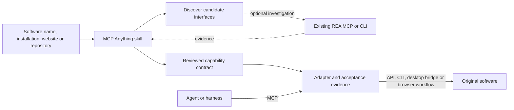

# Architecture and integration contract

MCP Anything is a reusable engineering skill for turning selected capabilities of existing software into MCP tools. A software name, installation path, website, database or repository can be the starting point. It combines target discovery, an explicit tool contract, adapter scaffolding and executable acceptance checks. Source code is optional.

“Anything” describes the range of targets the workflow can examine. Operations become supported only after implementation and verification for their actual environment. A generated scaffold remains unfinished. This project is independent of the MCP specification's example “Everything” server and is not a fork of REA.

## The three layers

The skill guides the engineering work. The adapter exposes chosen operations through MCP. The original software performs the operation. An installed adapter can serve a compatible MCP client without the converter skill. REA used during investigation is not automatically a runtime dependency; declare it only when the adapter actually calls REA during execution.

`discover_target.py` resolves PATH/Windows App Paths candidates, inventories selected directories without reading file bodies, and classifies URLs without fetching them. It does not prove any interface works. REA is invoked directly through an available MCP connection or installed CLI, so the project does not duplicate its analysis engine or installation manager. Recorded environments remain fixtures until actual target operations are separately verified.

Repository inspection is static by default: read source, manifests, licenses and documentation before deciding what to execute. Text found in an upstream README, issue, fixture or source comment is repository data, not authority to change the task, send credentials, or execute additional commands. Record a commit or release reference; a moving branch alone is insufficient provenance for a release.

## Select the boundary that the software actually offers

| Upstream interface | Adapter boundary | Engineering work still required |
|---|---|---|
| Command-line program | Fixed executable plus an argument array; no shell command string | Choose supported operations, input/output formats, exit/error handling, timeout and cancellation behavior |
| Python or other library | Explicit function wrappers with validated arguments | Select a stable API, handle exceptions and process-global state, prevent library output from corrupting MCP stdout |
| HTTP API | Restricted configured service plus defined routes | Authentication from runtime configuration, request timeouts, response schemas, rate limits and idempotency |
| Desktop scripting, COM or plugin | Named operations through the installed application's automation API | Select and own sessions, limit document access, verify saves, clean up only owned processes |
| Website UI | Business operations over a configured origin and dedicated browser context | Semantic selectors, login/session needs, readback after writes, explicit non-idempotent recovery |
| GUI-only or undocumented program | Investigate a supported route, optionally using REA | New workflows need a specific adapter and acceptance. General desktop UI control and universal reverse engineering are not implemented by this project |

Each tool contract records its purpose, parameter types and units, required files, produced files, side effects, failure states and testable success criteria. A generic `run_anything(command)` tool would evade this design. Secrets and deployment addresses belong in operator configuration, not generated source or examples.

## Acceptance is an observable result

A generated package has two different milestones: its MCP process can start, and its tools can correctly perform the requested upstream operation. Both must be checked. A useful acceptance record contains:

1. A real MCP client performing initialization, tool discovery and at least one meaningful tool call.
2. A small real upstream computation with retained input, version information and output; mocks alone cannot establish this.
3. Invalid-input and failure behavior appropriate to the exposed interface, including output/path limits and long-job cancellation where applicable.
4. Installation from the distributed artifact in a clean environment, using the documented commands.

The detailed release evidence identifies the tested operating system and engine. CI configuration expresses intended checks; it is not proof that a remote CI run has already passed. A new upstream version or platform requires its own validation.

## LAMMPS application

The adapter provides a controlled demonstration path and an explicitly enabled path for trusted LAMMPS inputs. LAMMPS is installed separately. The repository does not contain its executable, shared library, MPI runtime, force-field databases or a scientific dataset.

Long calculations use submission followed by status/result queries. The job supervisor and job files must have a lifetime independent of the MCP connection if a calculation is to continue after the client disconnects. The implementation's restart, timeout and cancellation tests determine which guarantees are claimed in the release evidence. A persisted status file by itself is not proof that the underlying calculation is still alive.

On Windows, start `python -m lammps_mcp.supervisor --workspace <absolute-workspace>` outside the MCP client's process tree before connecting. The SDK's Windows process cleanup can terminate all server descendants, including detached ones. The service therefore requires the separate supervisor on Windows and rejects new jobs if its heartbeat is missing. On POSIX, independent process sessions are used by default; the supervisor is available through `LAMMPS_USE_SUPERVISOR=1`. The standalone acceptance starts a separate supervisor and observes a running engine before disconnecting and reconnecting the client.

Trusted LAMMPS input is executable scientific input: commands and extensions may access files or invoke additional functionality. Enabling `LAMMPS_ALLOW_TRUSTED_INPUT=1` is an operator decision for reviewed inputs. Input filtering is not an operating-system security boundary. Use an appropriately isolated worker environment when users or inputs are untrusted.

The small Lennard-Jones example tests the integration. It does not measure a polymer's glass-transition temperature. A Tg study additionally needs a chemically validated structure, force field and charges, system size, equilibration, cooling protocol, repeated runs, fitting diagnostics and a justified experimental comparison. Outputs must preserve those conditions before being admitted to a scientific dataset.

## Streamable HTTP in 0.2.0

The same adapter also runs as a separately managed HTTP service. The default command remains stdio; HTTP is selected explicitly with `python -m lammps_mcp --transport streamable-http --host 127.0.0.1 --port 8765 --path /mcp`. HTTP uses stateless MCP requests and JSON responses. Stateless transport does not make the computation stateless: job identity, status and results remain in the configured workspace and are retrieved by UUID.

| Endpoint | Contract |
|---|---|
| `/mcp` by default | Streamable HTTP MCP initialization, tool discovery and tool calls; changed with `--path` |
| `GET /health` | Service version, configured MCP path, trusted-input setting and supervisor readiness; does not load or verify the LAMMPS engine |
| `GET /` | Service identity, version and endpoint information; not a simulation or browser UI |

HTTP and stdio expose the same seven tool names, but HTTP startup rejects `LAMMPS_ALLOW_TRUSTED_INPUT=1`. Consequently `lammps_submit` remains listed and returns an explicit disabled-input error. The shared HTTP capability is the bounded numerical LJ demonstration and its job-management operations; arbitrary scripts remain an operator-controlled stdio capability.

DNS rebinding protection stays enabled. `LAMMPS_MCP_ALLOWED_HOSTS` adds comma-separated, exact `host[:port]` authorities; it does not accept URLs or wildcard hosts. `LAMMPS_MCP_ALLOWED_ORIGINS` adds exact HTTP(S) origins without paths or wildcards. Loopback authorities and origins for the listening port are retained. When a platform proxy forwards requests, configure the values its request actually carries. These checks validate request routing and browser origin; they are not authentication, per-user authorization or a cross-user job boundary.

The HTTP service binds to loopback by default. Binding to `0.0.0.0` is a deliberate deployment choice and still requires platform routing, TLS/access control as appropriate, and a dedicated demonstration workspace. The package does not create a gateway or publicly reachable URL. All accepted clients share the workspace; a client with a job UUID can read or cancel that job. Do not use this version for confidential multi-tenant research workspaces.

A long-running HTTP server does not eliminate the worker-lifetime rules above. Windows still requires a supervisor started outside the client's service tree, and operators may select the same arrangement on POSIX. Engine availability is checked through `lammps_probe`; `/health` returning `status: ok` alone does not prove that a simulation can run. Deployment-specific acceptance must exercise the actual routed `/mcp` endpoint and a real engine job. The release evidence, not the presence of an HTTP launch command, determines whether a remote platform was validated.

## Client integration

Use an absolute executable and argument array for stdio, or a validated URL for Streamable HTTP. Install the adapter and its upstream dependencies in the selected runtime before connecting. Keep stdout for MCP and diagnostics on stderr. The MCP client may terminate the server and its descendants when it disconnects, so test the actual host lifecycle for long computations.

A successful MCP initialization proves transport compatibility only. Record a real tool call and observable upstream result for each claimed integration. Client-specific configuration formats and startup timeouts vary; follow the selected client documentation.
